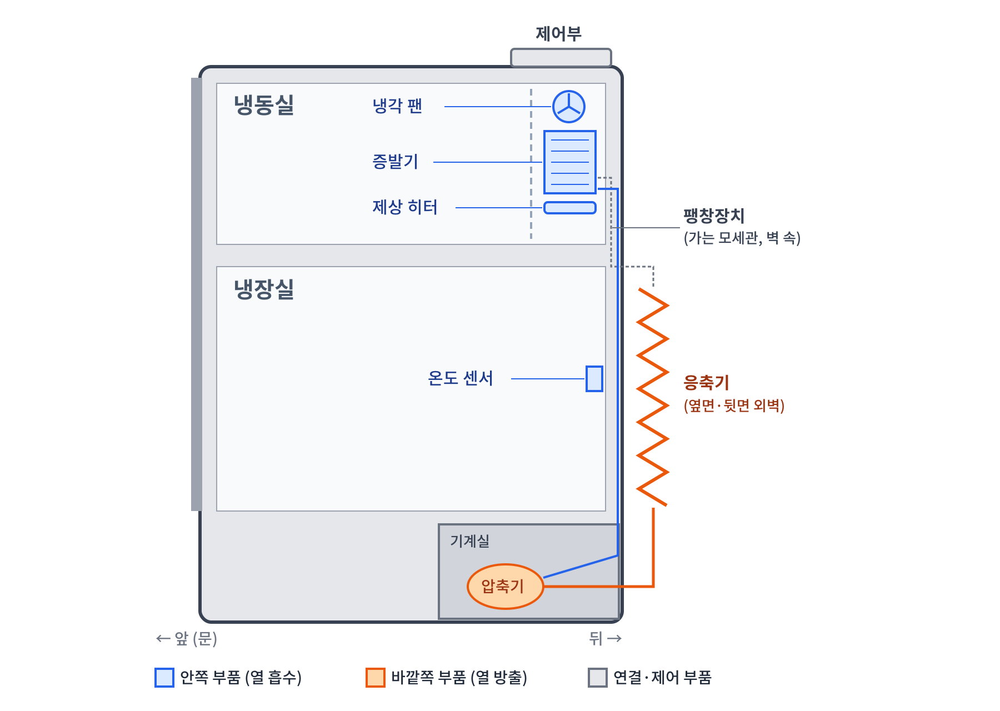
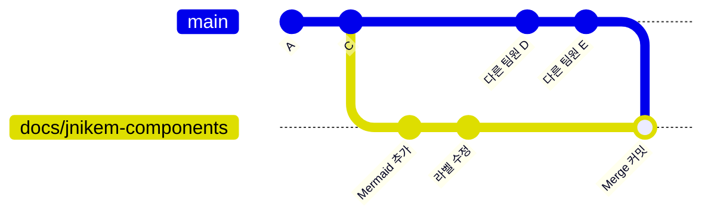

# 실전 적용: 6인 GitHub 문서 협업 (오픈소스SW기초 팀 과제)

> S1~S4에서 혼자 연습한 브랜치 · PR · merge를 6명 팀 과제에 실제로 적용한 기록입니다.

| 항목 | 내용 |
|---|---|
| 기간 | 2026.10.12 ~ 10.19 (7일) |
| 팀 | 6명, 1인 1문서 + README |
| 결과물 | [yunn1215/oss-team5](https://github.com/yunn1215/oss-team5) (보관용 fork: [jnikem/oss-team5-refrigerator-docs](https://github.com/jnikem/oss-team5-refrigerator-docs)) |
| 팀 전체 | main 커밋 255개, 머지된 PR 67개 |
| 내 담당 | `docs/02-components.md` 냉장고의 주요 부품 + README 팀원 정보 |
| 내 기록 | 커밋 22개 (10/12 ~ 10/18 중 6일), PR 9개, 다른 팀원 PR 리뷰 |

---

## 1. 팀 규칙 (첫날 README에 먼저 정함)

| 영역 | 규칙 | 이유 |
|---|---|---|
| 브랜치 | `docs/아이디-주제`, main 직접 커밋 금지 | 누가 무슨 작업을 하는지 이름만 보고 알 수 있게 |
| 커밋 | `docs:` 내용, `fix:` 수정 | 히스토리만 읽어도 문서가 어떻게 자랐는지 보이게 |
| PR | 템플릿(담당·작업 내용·그림·체크리스트 6개) + 리뷰 1명 | 분량·그림·출처 요건을 매번 스스로 점검 |
| 머지 | **Create a merge commit** 고정 | Squash는 커밋을 하나로 합쳐 개인 기록이 사라짐 (S2에서 3종 비교한 결과를 적용) |

## 2. 내가 한 일

- **02 문서 작성**: 소개 → 핵심 부품 4개 → 보조 부품 → 그림 → 정리 → 참고자료를 **섹션 1개 = 커밋 1개** 단위로 나눠 6일에 걸쳐 커밋
- **문서 간 경계 설계**: 02는 부품의 *위치와 역할*, 03(냉각 원리)은 *냉매가 흐르는 과정*으로 나누고, 겹치는 내용은 다시 쓰지 않고 링크로 넘김
- **그림 2개**: 부품 위치도(png)와 부품 연결도(Mermaid)
- **README 팀원 정보 PR** ([#16](https://github.com/yunn1215/oss-team5/pull/16)): 공동 파일이라 단톡에 먼저 알리고 `docs/readme` 브랜치에서 작업
- **리뷰**: 다른 팀원 PR에 링크 깨짐, 출처 누락, 문서 간 중복을 댓글로 지적

*02 문서 그림 1. 냉장고 부품 위치도*

## 3. 기억에 남는 장면 3개

### ① 리뷰로 merge 충돌 흔적을 찾아냄 ([#20](https://github.com/yunn1215/oss-team5/pull/20))

팀원의 04 PR에서 파일 중간에 `=======` 한 줄과 중복된 제목이 남아 있었다. main을 merge하다 충돌 표시를 덜 지운 흔적이다. 이 상태로 머지되면 Markdown이 `=======` 바로 윗줄을 큰 제목으로 렌더링한다.
→ 줄 번호를 짚어 댓글을 달았고, 작성자가 `docs: 충돌 표시와 중복 제목 제거` 커밋으로 고친 뒤 머지됐다.
**S2에서 충돌을 직접 재현해 봤기 때문에 한눈에 알아볼 수 있었다.**

### ② pull했더니 에디터가 열림: fast-forward vs merge 커밋

평소에는 `git pull origin main`을 하면 바로 끝났는데, 한 번은 `MERGE_MSG` 에디터가 열렸다.

- **평소**: 내 PR이 이미 머지된 뒤 pull → 내 브랜치에 main에 없는 커밋이 0개 → 끝만 따라가면 됨 (fast-forward)
- **이번**: 내 PR이 아직 열려 있는 동안 다른 팀원 PR이 먼저 머지됨 → **두 갈래가 생겨서** 묶는 커밋이 필요 → `core.editor`로 설정한 VS Code가 메시지를 물어봄
- 이후로는 `git pull --no-edit origin main`을 사용

### ③ Mermaid 라벨 겹침 → `fix:` 커밋

부품 연결도에서 증발기로 들어오고 나가는 화살표의 라벨("저압 액체", "저압 기체")이 같은 자리에 겹쳤다. Mermaid는 배치를 자동으로 하므로 위치를 직접 옮길 수 없다. **겹치는 라벨 2개를 빼고, 그 정보는 본문에 이미 있으니 그림에서는 생략**하는 쪽으로 해결했다.

## 4. 아쉬운 점 (다음에 고칠 것)

- **셀프 머지**: 내 PR 9개 중 6개를 내가 머지했다. 일부는 리뷰 댓글을 받은 뒤였지만, "리뷰어가 머지" 규칙을 지키지 못한 경우가 있었다. 다음에는 main에 branch protection(승인 1명 필수)을 처음부터 거는 쪽을 제안하겠다.
- **커밋 메시지 실수**: 개요+요약표 커밋에 "압축기" 메시지를 잘못 붙였다. push한 뒤라 rebase와 force push 대신 PR 본문에 기록하는 쪽을 택했다. 커밋 직전에 메시지를 한 번 읽는 습관이 필요하다.
- **10/17 커밋 0개**: 기간 점수를 생각하면 하루가 비었다.

## 5. 정리

| 연습(S1~S4) | 실전에서 쓰인 곳 |
|---|---|
| merge 3종 비교 | 팀 머지 방식을 merge commit으로 고정 |
| 충돌 재현과 수동 해결 | 리뷰에서 남은 충돌 표시 발견 (#20) |
| 열린 PR에 커밋 자동 반영 | Draft/열린 PR에 섹션 커밋을 이어 붙임 |
| `git status -s` 확인 습관 | `add .` 전에 다른 팀원 파일이 섞이지 않았는지 확인 |

> 이 회고와 02 문서의 일부 초안, 그림 1은 AI 도구의 도움을 받아 작성했고, 내용은 직접 검토했습니다. Git 명령과 커밋은 직접 실행했습니다.
